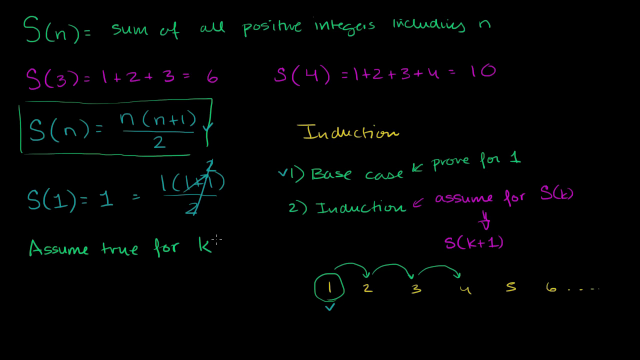
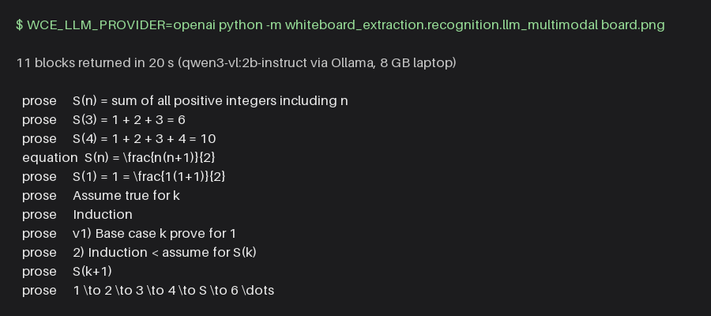

# Recognition backend: multimodal LLM (issue #13)

`MultimodalLLMRecognizer` in `src/whiteboard_extraction/recognition/llm_multimodal.py` is the
second DL recognition method. It sends one cropped board image to a multimodal LLM and turns the
reply into `RecognizedBlock` objects, exactly like the other backends behind the `Recognizer`
protocol in `recognition/base.py`.

It is one backend with two interchangeable transports, chosen by configuration:

| Provider | Talks to | Key | Default model | Default base URL |
| --- | --- | --- | --- | --- |
| `anthropic` (default) | Anthropic Claude API via the `anthropic` SDK | `ANTHROPIC_API_KEY` | `claude-opus-5-5` | SDK default |
| `openai` | Any OpenAI chat-completions endpoint, standard library only | none by default (Ollama); a key for hosted services | `qwen3-vl:2b-instruct` (an Ollama tag) | `http://localhost:11434/v1` (Ollama) |

The same prompt, parsing, validation and error behaviour apply to both.

## Example

A frame from the team's induction clip (`docs/images/llm_demo_board.png`) and what the local
`qwen3-vl:2b-instruct` model returned for it:





The text is read accurately; the small model's weak spot is the kind label, where lines of
mathematics are often returned as prose.

## Configuration

Constructor arguments win over environment variables, which win over the defaults above.

| Variable | Meaning |
| --- | --- |
| `WCE_LLM_PROVIDER` | `anthropic` or `openai`. |
| `WCE_LLM_MODEL` | Model id used when the caller passes an empty name (the evaluation script's `--llm-model` and the web app's `config.llm_model` are passed positionally and win). |
| `WCE_LLM_BASE_URL` | Endpoint base URL. For `openai` the backend posts to `{base_url}/chat/completions`. |
| `WCE_LLM_API_KEY_ENV` | The **name** of the variable that holds the key, for example `OPENROUTER_API_KEY`. Unset with `openai` means no `Authorization` header (Ollama). Set but empty raises a clear `RuntimeError`. |
| `WCE_LLM_TIMEOUT` | Seconds to wait for one reply (default 600). Raise it for slow local models. |
| `WCE_LLM_REASONING_EFFORT` | (`openai`) the `reasoning_effort` value to send. Default `auto`: `low` for local servers such as Ollama, nothing for hosted ones. `omit` never sends it. See *Thinking models*. |
| `WCE_LLM_JSON_SCHEMA` | (`openai`) send the blocks JSON schema as `response_format`: `auto` (default: local servers only), `on` or `off`. See *Thinking models*. |
| `WCE_LLM_EXTRA_BODY` | (`openai`) a JSON object merged into the request body last, for provider-specific fields, for example `{"temperature": 0}`. |
| `ANTHROPIC_API_KEY` | The key for the `anthropic` provider, read on the first `recognize` call, never at construction. |
| `ANTHROPIC_BASE_URL`, `ANTHROPIC_LOG` | Honoured by the SDK (proxy or gateway; `debug` request logging). |

Keys are never read from code or config files. Never paste a key into a notebook or a commit.

## How to run it

Install first: `pip install -r requirements.txt && pip install -e .` (the `anthropic` SDK is in both
dependency lists; the `openai` provider needs nothing extra).

### Anthropic (default)

```bash
export ANTHROPIC_API_KEY=sk-ant-...
python -m whiteboard_extraction.recognition.llm_multimodal path/to/board.png
```

### Ollama (local, free, no key)

Install Ollama with `brew install ollama` (or the installer from ollama.com) and keep it up to date; old releases refuse newer models.
The default local model is `qwen3-vl:2b-instruct`, a small vision model that fits an 8 GB M3 laptop.
Mind the tag: Ollama's bare `qwen3-vl:2b` and `qwen3-vl:4b` tags are the **thinking** variants (same
digest as `qwen3-vl:2b-thinking` on the tags page), which reason at length before answering and fill
the default context window; the `-instruct` variants answer directly and are the ones to use here.

1. Download the model once (about 1.9 GB; this is a deliberate step, nothing downloads it for you):

   ```bash
   ollama pull qwen3-vl:2b-instruct
   ```

2. Make sure the server is running: the Ollama menu-bar app runs it, or start it with `ollama serve`.
   The backend tells you when it cannot reach `localhost:11434`.

3. Run with the `openai` provider. Everything else defaults to Ollama:

   ```bash
   WCE_LLM_PROVIDER=openai python -m whiteboard_extraction.recognition.llm_multimodal path/to/board.png
   ```

   or `--provider openai` on the command line, or `MultimodalLLMRecognizer("", provider="openai")` in code.

What to expect on an 8 GB laptop: the 4b models are too slow there; `qwen3-vl:2b-instruct` answered
all 12 board frames sampled from the team's two test clips (640 px wide) at about 9 seconds per frame,
including the first call that loads the model, and the slope and induction formulas came out as
correct LaTeX (`qwen3-vl:4b-instruct` with `--model` or `WCE_LLM_MODEL` if you have the memory).
Settings that help:

- `--max-image-side 480` to `1280` (or `max_image_side=`): fewer image tokens, faster, and on Ollama
  also less of the context window used (see below). Small boards stay legible surprisingly far down.
- `WCE_LLM_TIMEOUT=900` (or `--timeout 900`) if frames time out.

#### Thinking models

The thinking variants (`qwen3-vl:2b`, `qwen3-vl:2b-thinking`, ...) reason before they answer, and on
Ollama the reasoning counts against the context window, which Ollama sizes by available memory (4k
tokens on an 8 GB Mac). The model can spend the whole window on reasoning and return an empty answer
with `finish_reason: length`; the backend then raises a `RuntimeError` that says so, with the start
of the reasoning. On the Ollama build tested (0.40, `qwen3-vl:2b`) thinking cannot be switched off:
the model's template has no switch, so `reasoning_effort: "none"`, a nested `reasoning` object,
`/no_think` in the prompt and even the native API's `think: false` all still produce reasoning. The
real fix is the `-instruct` tag. If you must run a thinking model, these reduce the failures but do
not remove them (the reasoning length varies from call to call, and a 480x270 board still overflowed
the 4k window in one of four live runs):

- **`reasoning_effort: "low"`**, sent to local servers by default, shortens the reasoning so the
  answer usually fits. Override with `WCE_LLM_REASONING_EFFORT` (a level, or `omit`). A model that
  does not think rejects the field; the transport then drops it, see below.
- **A JSON-schema `response_format`**, also sent to local servers by default (`WCE_LLM_JSON_SCHEMA`),
  pins the reply to the array of `{text, kind}` objects. Without it the small model now and then
  answers with a bare list of strings, which the parser rejects. `on` sends it to hosted endpoints
  too (Gemini, OpenRouter and Groq accept it for most models); `off` never sends it.
- **Small boards.** Image tokens and reasoning both live in the same 4k window, so keep local-model
  inputs around 480x270 to 640x360 (`--max-image-side 640`). A 1200x600 board overflowed the window
  on `qwen3-vl:2b` even at low effort.
- **A larger window** if you need bigger boards or more reasoning: start the server with
  `OLLAMA_CONTEXT_LENGTH=8192 ollama serve`, or for the brew service set it for launchd
  (`launchctl setenv OLLAMA_CONTEXT_LENGTH 8192`) and `brew services restart ollama`. Ollama's docs
  also describe a Modelfile with `PARAMETER num_ctx`. It has to be server-side: the OpenAI-compatible
  endpoint silently ignores `num_ctx` in the request (top level or under `options`); only the native
  `/api/chat` honours `options.num_ctx`. Raising `max_tokens` does not help either: the observed
  failure stopped at 4096 total tokens with `max_tokens` at 8192.

On real footage the thinking variant is worse than on synthetic boards: six board frames from the
team's two test clips produced 7-8k characters of reasoning each and zero answers at 4k context, even
though the reasoning shows the board was read correctly. Use the `-instruct` tag or a larger window.

Both automatic fields are safe for other local models: a model without thinking support rejects
`reasoning_effort` with HTTP 400 (`"llava" does not support thinking`), and a server without structured
output rejects `response_format`. When the field came from the default, the transport drops it for
that model and retries once; an explicitly configured value is never retried, so the error surfaces.
Inline `<think>...</think>` blocks, which some servers put into `content`, are stripped before parsing.

Small models follow "JSON only" less reliably than frontier models. The parser strips Markdown fences
and prose around the array, so that is usually fine; a `RuntimeError` naming the reply means no array
was found at all. Any other **vision** model you have pulled works with `--model <tag>`; a model that
is not pulled yields Ollama's `HTTP 404 ... model 'x' not found`, passed through with a reminder to
pull it. A text-only model such as `llama3.2` is rejected by Ollama 0.40 with `HTTP 400 ... model does
not support multimodal requests` (Ollama 0.15 accepted the image and let the model invent a board, so
upgrade if you see plausible nonsense). Ollama's hosted service (`https://ollama.com/v1`, key in
`OLLAMA_API_KEY`) is the same shape with a key.

### Hosted free tiers (OpenAI-compatible, with a key)

All of these use the `openai` provider with a base URL and the name of the variable holding the key.
Free tiers have daily request caps, so they suit the labelled evaluation set, not whole lectures
(a lecture yields hundreds of keyframes).

| Service | `WCE_LLM_BASE_URL` | `WCE_LLM_API_KEY_ENV` | Model |
| --- | --- | --- | --- |
| Google AI Studio (Gemini) | `https://generativelanguage.googleapis.com/v1beta/openai/` | `GEMINI_API_KEY` | e.g. `gemini-3.8-flash` (the id used in Google's examples; check the current list) |
| OpenRouter | `https://openrouter.ai/api/v1` | `OPENROUTER_API_KEY` | a vision model marked free in the catalog |
| Groq | `https://api.groq.com/openai/v1` | `GROQ_API_KEY` | check the model list for a current vision model |

GitHub Models was retired on 2026-07-30 and is no longer an option. Example:

```bash
export GEMINI_API_KEY=...
WCE_LLM_PROVIDER=openai \
WCE_LLM_BASE_URL=https://generativelanguage.googleapis.com/v1beta/openai/ \
WCE_LLM_API_KEY_ENV=GEMINI_API_KEY \
python -m whiteboard_extraction.recognition.llm_multimodal --model gemini-3.8-flash path/to/board.png
```

### From Python and from the evaluation script

```python
import cv2
from whiteboard_extraction.recognition.llm_multimodal import MultimodalLLMRecognizer

recognizer = MultimodalLLMRecognizer("")          # provider and model from WCE_LLM_* or the defaults
blocks = recognizer.recognize(12.5, cv2.imread("board.png"))
for block in blocks:
    print(block.kind, block.text)
```

Once the issue #14 branch is merged, the same configuration drives the evaluation script:

```bash
WCE_LLM_PROVIDER=openai python scripts/evaluate.py --test-set data/raw/eval_boards --method llm --llm-model qwen3-vl:2b-instruct
```

### Smoke test on a lecture video

`scripts/extract_board_frames.py` samples frames from a clip, crops them to the board when it has
boxes, and can push each frame through the backend. It is the quickest way to see the backend on real
footage before the video pipeline and the recognizer are wired together.

```bash
# every 10 s, full frames, downscaled to 640 px, into data/processed/<clip>_frames/
python scripts/extract_board_frames.py data/raw/test_footage/calculus_clip_1.mp4 --every 10

# the keyframes and board boxes the video pipeline (#37) chose, every 8th one, then recognize
python scripts/extract_board_frames.py data/raw/test_footage/calculus_clip_1.mp4 \
    --manifest data/processed/2_board_detection/calculus_clip_1/manifest.csv --stride 8 \
    --recognize --provider openai --model qwen3-vl:2b-instruct
```

The output folder holds one PNG per frame, `frames.csv` (timestamp, crop box, size) and, with
`--recognize`, `blocks.json` with the blocks or the error per frame; a failing frame does not stop
the run. `--at 12 40 75` samples explicit times, `--box X Y W H` applies one crop everywhere, and
`--limit N` keeps the run short. The team's clips live in Git LFS on the `feature/8-board-segmentation`
branch (`data/raw/test_footage/`, with `sources.md` naming their origin); without `git lfs`, fetch a
clip from `https://media.githubusercontent.com/media/<owner>/<repo>/<branch>/<path>`.

### Constructor options

| Argument | Default | Meaning |
| --- | --- | --- |
| `model` (positional) | `""` | Model id, stored as `.model`. Empty -> `WCE_LLM_MODEL` -> the provider default. |
| `provider` | `None` | `"anthropic"` or `"openai"`. Empty -> `WCE_LLM_PROVIDER` -> `"anthropic"`. |
| `client` | `None` | (anthropic) a pre-built SDK client or any object with a compatible `messages.create`. |
| `http_client` | `None` | (openai) an object with `post(url, headers, payload, timeout) -> dict`; default uses `urllib`. |
| `base_url` | `None` | Endpoint base URL. Empty -> `WCE_LLM_BASE_URL` -> provider default. |
| `api_key_env` | `None` | Name of the variable holding the key. Empty -> `WCE_LLM_API_KEY_ENV` -> `ANTHROPIC_API_KEY` for anthropic, none for openai. |
| `max_tokens` | `8192` | Output cap. A truncated reply raises `RuntimeError` telling you to raise it. |
| `max_image_side` | `2576` | Longest side sent, in pixels. See *Cost*. |
| `effort` | `None` | Optional `output_config.effort` for the anthropic provider only. |
| `timeout` | `None` | Seconds per request. Empty -> `WCE_LLM_TIMEOUT` -> 600. |
| `reasoning_effort` | `None` | (openai) `reasoning_effort` to send. Empty -> `WCE_LLM_REASONING_EFFORT` -> `auto`. |
| `json_schema` | `None` | (openai) `auto`, `on` or `off` for the schema `response_format`. Empty -> `WCE_LLM_JSON_SCHEMA` -> `auto`. |
| `extra_body` | `None` | (openai) dict merged into the request body last. Empty -> `WCE_LLM_EXTRA_BODY`. |
| `collapse_repeats` | `True` | Drop a block that repeats the previous one (same kind and text). Small models loop on a formula; turn off to measure the raw output. |

### Tests

```bash
pytest tests/test_recognition.py
```

The unit tests never touch the network: a fake SDK client covers the Anthropic path, a fake HTTP
client covers the OpenAI-compatible path, and a loopback `http.server` exercises the real `urllib`
client (success, HTTP 404 with the server's message, connection refused, non-JSON reply). The
autouse fixture clears `WCE_LLM_*` so a developer's shell settings cannot change the unit tests.

Two tests are marked `real_llm` and skipped unless configured: the Anthropic one needs
`ANTHROPIC_API_KEY`; the OpenAI-compatible one runs only when `WCE_LLM_PROVIDER=openai` and
takes the endpoint and model from the `WCE_LLM_*` variables. CI runs `pytest -m "not real_video"`,
where both are skipped because nothing is configured. Locally, after `ollama pull qwen3-vl:2b-instruct`:

```bash
WCE_LLM_PROVIDER=openai pytest -m real_llm
```

## Cost

**Anthropic.** Images are billed by area: an image costs `ceil(width / 28) * ceil(height / 28)` input
tokens. Models from Claude 4.7 onward are in the high-resolution tier, which accepts up to 2576 px on
the long edge (4784 tokens). Anything larger is downscaled by the API anyway, so the backend downscales
locally to `max_image_side` before encoding to save upload time; lower the setting to save tokens.

Rough figures for one keyframe on the default model (`claude-opus-5-5`, $4 per million input
tokens, $20 per million output tokens at the time of writing):

| Item | Tokens | Cost |
| --- | --- | --- |
| 1920x1080 keyframe at the default `max_image_side` | 2691 | $0.011 |
| Same keyframe with `max_image_side=1280` (1280x720) | 1196 | $0.005 |
| Prompt text | ~350 | $0.001 |
| Reply (JSON for a full board, plus the model's own reasoning, which is billed as output) | 300-1500 | $0.006-$0.030 |

So budget roughly 2 to 5 cents per keyframe, or a few dollars for a lecture that yields about 100
keyframes. Levers, cheapest first: `effort="low"`, `max_image_side=1280`, a cheaper model
(`claude-sonnet-5-5` is half the price per token, `claude-haiku-5-5` about forty times cheaper).
Limits that matter for whole-lecture runs: 10 MB per base64 image and 32 MB per request on the
Claude API; the SDK retries rate limits and server errors twice.

**Ollama** costs nothing per frame; you pay in time and in accuracy of a small model. **Hosted free
tiers** cost nothing within their daily caps, which a whole lecture exceeds.

## Prompt design

The instructions live in a **system prompt** (`SYSTEM_PROMPT`), identical for every frame and for
both providers; the user turn carries the image first and a one-line instruction (`USER_PROMPT`)
after it, the order the vision docs recommend. The system prompt asks for:

- **Only a JSON array**, no prose and no code fences. Each element has `text` and `kind`, and the
  prompt ends with a one-line example of the exact shape, which small models follow much better.
- **`kind` is `"prose"` or `"equation"`**, which matches `RecognizedBlock.kind` and the labels the
  evaluation script scores. The rule is deliberately mechanical: any line containing mathematics (an
  equals sign, inequality, fraction, exponent, function value, sum) is an equation even with a few
  words around it, and prose is only for lines made of words. Frontier models follow this; the 2b
  Ollama model does not (measured on the same twelve frames before and after the rule was sharpened, it
  still tagged lines like `S(3) = 1 + 2 + 3 = 6` as prose, 24 then 28 kind errors), so expect low kind
  accuracy from small local models whatever the prompt says. Equations are written as **LaTeX without
  `$` delimiters** so the export stage can render them; prose is plain text.
- **Board order**: top to bottom, then left to right across columns, one block per written line or
  expression and each line exactly once, so the reconstruction stage can keep the lecturer's order.
- **Transcribe, do not interpret**: no corrections, no commentary, no description of diagrams,
  erased ghost marks ignored. Keeps the output comparable to ground truth and keeps drawings from
  polluting the word error rate.
- **`[]` for a blank board**, so empty keyframes produce no blocks instead of an error.

Parsing is deliberately tolerant of the ways models drift from "JSON only": Markdown fences are
stripped, prose around the array is ignored, a `{"blocks": [...]}` wrapper is unwrapped, `kind` is
case-normalised, blocks with empty text are dropped, and a block that repeats the previous one is
dropped (`collapse_repeats`, on by default), since small models sometimes loop on a formula: on the
team's calculus clip this removed every repetition loop (five consecutive copies of one formula in
the worst frame) with no other change. Everything else is strict and raises
`RuntimeError` with an excerpt of the reply: no JSON array, an element that is not an object, a
missing `text`, or a `kind` outside the two allowed values. An optional numeric `confidence` is kept
when the model volunteers one, otherwise `RecognizedBlock.confidence` is `None`.

Other failure modes also surface as `RuntimeError`, with the original exception chained: SDK, HTTP
and network errors (with the server's own message, so Ollama's "model not found" reaches you),
a refusal (`stop_reason: refusal` or `finish_reason: content_filter`), a reply cut off by the token
cap, a thinking model that returned only reasoning (`reasoning` / `reasoning_content` field or an
unterminated `<think>` tag) and a response with no text at all. Pipeline code can therefore catch one
exception type per frame.

### Request shapes

- `anthropic`: `messages.create(model, max_tokens, system, messages=[user: image block (base64 PNG),
  text])`, plus `output_config={"effort": ...}` when set. Thinking is left at the model default and no
  sampling parameters are sent, following the current API guidance.
- `openai`: `POST {base_url}/chat/completions` with `{"model", "max_tokens", "messages": [system,
  user: image_url part with a `data:image/png;base64,...` URL, text part]}`; `Authorization: Bearer`
  only when a key variable is configured; `reasoning_effort` and the schema `response_format` only
  for local servers by default, and `WCE_LLM_EXTRA_BODY` merged last. Nothing else is
  provider-specific, so Ollama, Gemini, OpenRouter and Groq all accept it.

`MultimodalLLMRecognizer.build_request(png_b64)` returns the exact request for inspection, and a
custom `client`/`http_client` can adapt it to anything else.

## Follow-up ideas

- Enforce the schema with structured outputs (Anthropic `output_config.format`, OpenAI-style
  `response_format`) instead of prompt-and-parse, once the team settles on providers.
- Run offline evaluations through the Anthropic Message Batches API for half-price tokens.
- Tune `effort`, `max_image_side` and the Ollama model size against the evaluation metrics once
  labelled boards exist.
