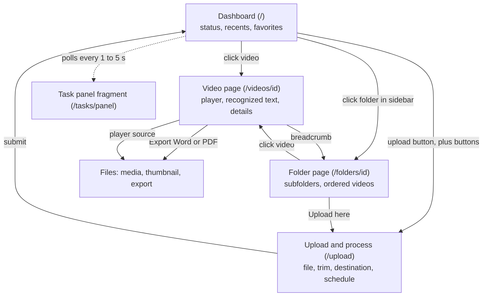
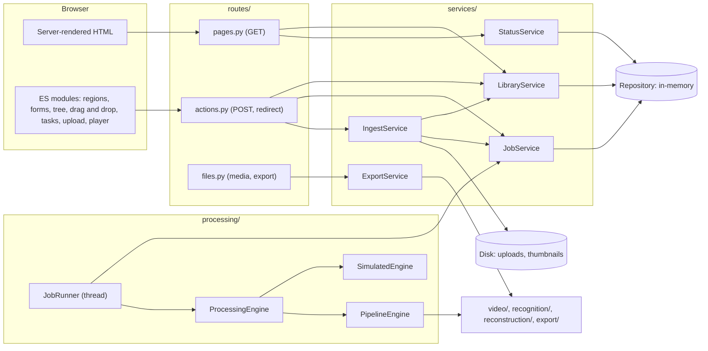
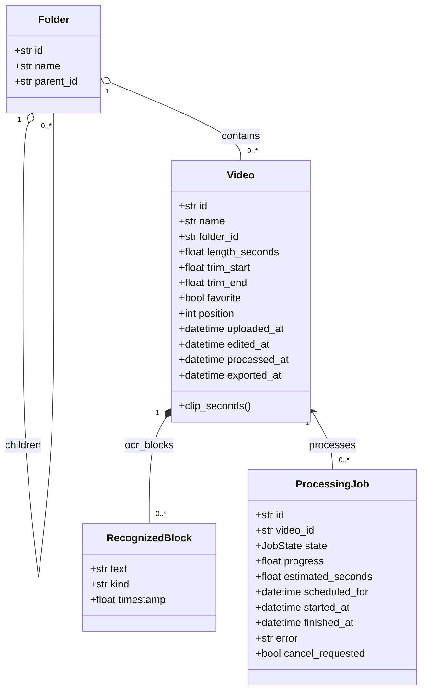
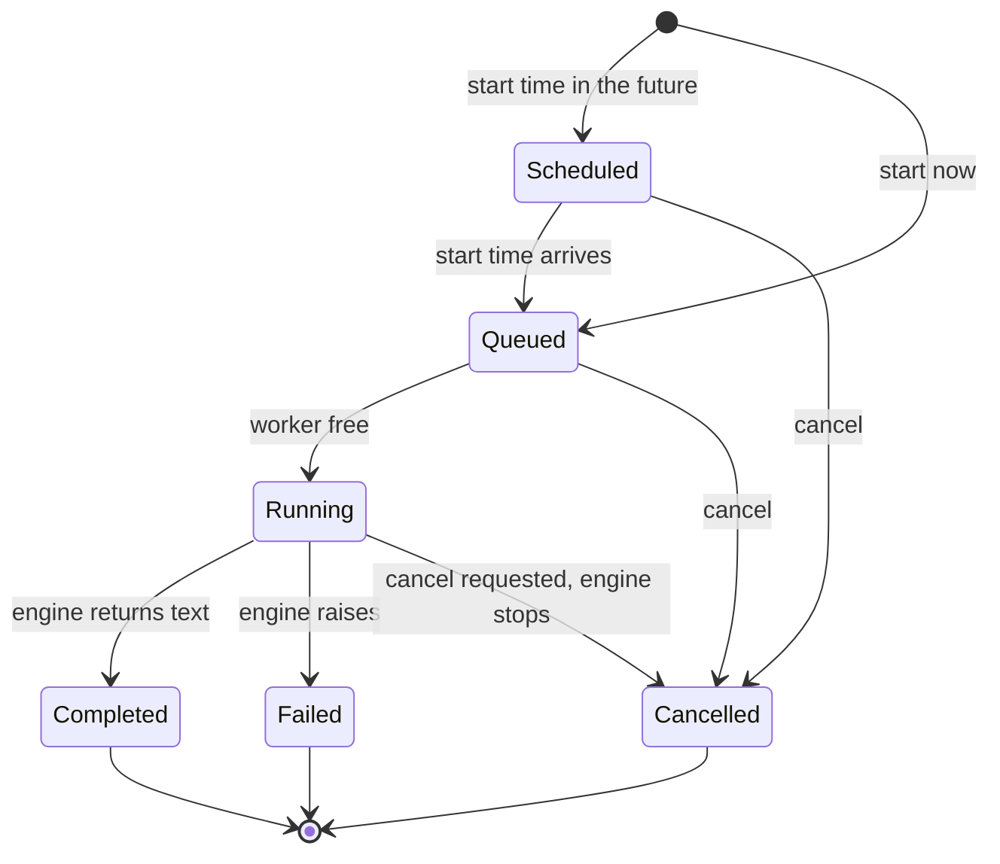
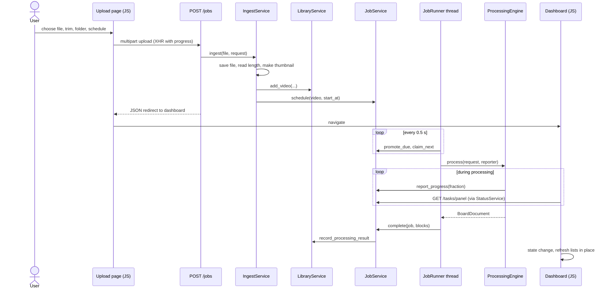
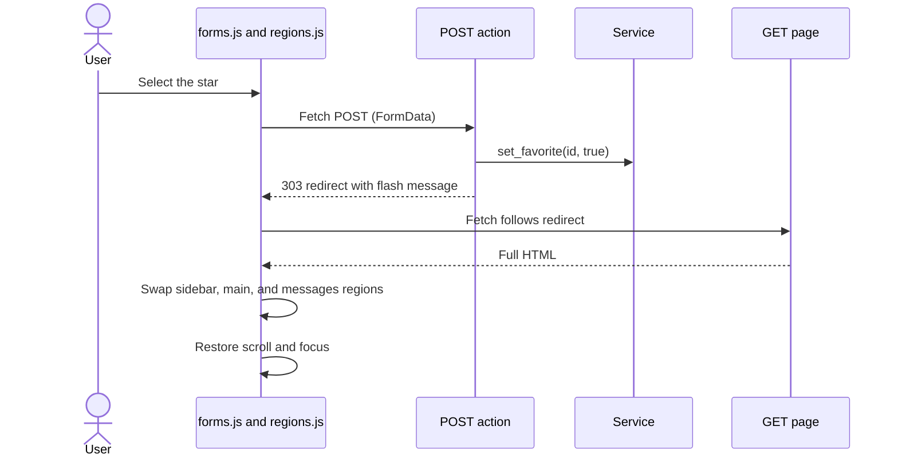

# Web app design

This document specifies the web application's pages, the behavior of each element, the design principles behind design decisions, and how the parts of the system connect.

## 1. Goals

- Give an instructor a quick answer to their two primary questions: "is the system healthy?" and "are my recent videos done?".
- Make the library feel like a file system with folders, ability to organize by dragging and dropping, and editable names and attributes.
- Take a video from upload to exported Word or PDF document without leaving the browser and without a command line.
- Stay usable with a keyboard, a screen reader, and a phone, because the primary goal of the whole system is accessibility.

## 2. Design decisions

| Question | Decision | Reasoning |
|---|---|---|
| How can videos be organized? | A file-system-like interface allowing nested folders containing videos at any level. | File system is recognizable to all target users and will allow for many user-specified organization schemes. |
| Do folders nest? | Yes. | The file system needs to allow depth, which can be achieved with minimal complexity. |
| Can a video sit outside any folder? | Yes, the top level is called "My files" and can directly hold videos. | Users do not have to make a choice about organization before uploading their first video. |
| How are names for folders and videos managed? | Names are stored and displayed exactly as typed, with leaning and trailing whitespace trimmed. Folder names are unique for each parent folder, ignoring case. | Names are assigned by user's and should be used as entered by the system. |
| What is in "Recents"? | The eight videos with the latest activity (upload, edit, process, export). | Videos which are most recently interacted with or finished processing matter most to users. |
| What does the status area mean? | The status area tracks four types of items: Processing now, Waiting to start, Completed in the last 24 hours, Failed. The status area uses these headlines to summarize activity and gives information about the recognition engine in use. | These types of items are most important to know at a glance. |
| How is processing progress shown? | A floating panel in the bottom right displays name, length, elapsed time, time remaining estimate, and a progress bar for videos being processed. Rows show a status badge with an icon and word. | Tasks should be tracked by their progress. |
| What are the rules for deleting a video? | A video that is running cannot be deleted and must be cancelled first. A folder must be empty to be deleted. Deletions ask for confirmation. | Accidental loss of work must be prevented. |
| How can videos be trimmed? | Optional start and end times can be specified before processing. The whole file is stored and only the chosen range is processed. | Minimize the work the system must do while keeping the original video available for playback: this is not a video editor. |
| How is work scheduled by the system? | As soon as a worker is free, it may start on a new piece of work. Videos can be scheduled for processing at a chosen date and time. By default, one job runs at a time while others wait in order. | This matches the one-times-runtime budget on shared hardware. |
| How can items be reordered or rearranged? | Dragging a row onto another will place it before. Arrow buttons also work. | Users should be able to arrange their videos how they wish whether they use a keyboard alone or with a mouse. |
| Can recognized text be edited? | Yes, text, timestamps, and block types can be edited manually, or marked for reprocessing. | This allows users to correct recognition errors and verify recognized content with minimal extra processing cost. |
| How are videos dated? | Dates are tracked for uploading, editing (with type of edit), processing, and exporting. | Users can easily see when videos were last touched. |
| Where does an upload go after it is complete? | Processed videos go to the dashboard, where the task panel shows it. | The dashboard shows all key system status. |

## 3. Site map



Every page shares the sidebar with file tree, content column, and floating dock with task panel and upload button.

## 4. Layouts

## Application shell (desktop)

```
+--------------------+-------------------------------------------------------------+
| [logo] Whiteboard  |  Dashboard                                        (profile) |
| Content Extraction |  [message banner, dismissible]                              |
|--------------------|-------------------------------------------------------------|
| MY FILES   [+f][+] |  [ Upload a video ]                                         |
|--------------------|  Status                                                     |
| v [folder] CS_593  |  Processing 1 video, with 2 waiting.                        |
|   v [folder] Wk 1  |  +----------+ +----------+ +--------------+ +-------------+ |
|     [vid] Intro    |  |    1     | |    2     | |      3       | |      0      | |
|   [vid] Video 2    |  |Processing| | Waiting  | | Completed in | | Failed, need| |
|   [vid] Video 1 *  |  |   now    | | to start | | last 24 h    | | attention   | |
| > [folder] MA_375  |  +----------+ +----------+ +--------------+ +-------------+ |
| [vid] loose video  |  Recognition engine: Simulated engine                       |
|                    |                                                             |
|  (tree scrolls)    |  Recents                                                    |
|                    |   NAME            UPLOADED   LENGTH  LOCATION   STATUS      |
|                    |  *[img] Video 6   Oct 12     1:30:03 MA_375     Processed   |
|                    |  o[img] Video 5   Oct 12     1:15:53 MA_375     Processing  |
|                    |  (one row per video, all fields on one line)                |
|                    |  Favorites                                                  |
|                    |  *[img] Video 1   ...                                       |
|                    |                              (main scrolls)                 |
|                    |                         +-------------------------+         |
|                    |                         | Tasks (2)               |         |
|                    |                         | Video 5   1:15:53       |         |
|                    |                         | [=====>    ] 42%        |         |
|                    |                         | Elapsed 0:12 About 0:17 |         |
|                    |                         +-------------------------+  ( + )  |
+--------------------+-------------------------------------------------------------+
```

Notes:
- The sidebar tree and the main content scroll independently, while the page itself doesn't scroll.
- `[+f]` creates a top-level folder. `[+]` opens the upload screen. Each folder row also shows a `+` on hover or keyboard focus which opens the upload screen with that folder preselected.
- The floating dock sits on the bottom right, with the task panel and a large round plus button. When there are no tasks, the panel is hidden. The panel is always collapsable.
- The star is the first column of each row to make favoriting a video easy.

## Video row

```
[star] [thumb] Name (ellipsis)      Date      [clock] Length   [folder] Location   [badge] Status   [trash]
2.75rem 4.5rem 1fr                  7.5rem    5.5rem           7 to 11rem          8.5rem           2.75rem
```

Folder pages add up and down arrow buttons before the trash button. Below 64em, the row becomes two lines: start, name, and actions; date, length, location, and status.

## Folder page

```
My files > CS_593_application_deep_learning > Week 1
[folder] Week 1             [Upload here] [New subfolder] [Rename] [Delete folder]

Folders:  [folder] Quiz review   [folder] Labs
Videos:   Drag a video onto another to reorder it, or onto a folder in the sidebar to move it.
          NAME ... STATUS  [up][down][trash]
```

## Video page

```
My files > CS_593 > Video 1
Video 1                       [Favorite] [Export Word document] [Export PDF]

+--------------------------------------------+  +-- Details ---------------------+
|                                            |  | Status     [Processed]         |
|              video player (16:9)           |  | Length     1:35:16             |
|                                            |  | Uploaded   Jun 1, 2026, ...    |
+--------------------------------------------+  | Edited     Not yet             |
Recognized text                                 | Processed  Jun 1, 2026, ...    |
 [1:05][play][Prose v][ ] Remove                | Exported   Not yet             |
 [textarea...................................]  | Name  [ Video 1      ][Rename] |
 [New block at 0:00][Prose v]                   | Location [CS_593 v   ][Move]   |
 [Save text]                                    | [Delete video]                 |
                                                +--------------------------------+
```

## Upload and process page

```
My files > Upload a video
Upload and process a video
[error message, if any]
+ 1. Choose a video ----------------------------------------------------------------+
|  Video file [Choose file]   MP4, MOV, MKV, WEBM, or AVI, up to 4 GB               |
+ 2. Trim (optional) ---------------------------------------------------------------+
|  [preview player]                                                                 |
|  Start [0:00 ] [Use current position]   End [End of video] [Use current position] |
+ 3. Save to -----------------------------------------------------------------------+
|  Name [Uses the file name]   Folder [My files v]                                  |
+ 4. When to start -----------------------------------------------------------------+
|  (o) Start as soon as a worker is free   ( ) Schedule for later                   |
|  Start at [date and time]                                                         |
+-----------------------------------------------------------------------------------+
[progress bar while uploading]
[Add to queue]
```

The preview and "Use current position" buttons appear after a file is chosen, but times can be entered manually without them.

## Narrow screens

Below 48em width, the sidebar stacks above the content and the page scrolls normally. Rows use the two-line layout, and the dock stays at the bottom right.

## 5. Interaction specifications

| Element | Behavior | Keyboard and assistive technology |
|---|---|---|
| Folder toggle | Chevron collapses or expands children. State remembered per browser. Current page folder is always shown. | Button with `aria-expanded` and `aria-controls`. |
| Drag a video | Rows and tree entries are draggable. Dropping onto a folder moves it to the end, droppong on a video places before it, and dropping on "My files" moves to the top level. The target for dropping is highlighted. | Arrow buttons on folder pages, and "Location" menu on the video page. |
| Star | Sets the favorite state (not a toggle), updates every list in place, keeps keyboard focus. | Button with `aria-pressed`; label "Favorite: name". |
| New folder | Plus button opens an inline form; Escape or an outside click closes it. | `details` and `summary`, so it works without JavaScript. |
| Delete | Browser confirmation, then in-place update. | Confirmation text names the item. |
| Task panel | Polled every second while a task is active, every five seconds otherwise. A change of task state refreshes the page's lists. Finished tasks stay for 30 seconds. | Progress bars use `role="progressbar"`; messages use a polite live region. |
| Upload | Preview and trim helpers, byte progress while uploading, errors shown above the form with the typed values kept. | Errors use `role="alert"` and receive focus. |
| Recognized text | Timestamp play buttons seek the player. Saving rebuilds the list; invalid timestamps are reported and nothing is saved. | Every field has a label. |
| Skip link | First focusable element; jumps to the main content. | Hidden until focused. |

## 6. Principles that shaped the design

| Decision | Principle |
|---|---|
| Task panel, status tiles, progress bars, badges with icon and word | Visibility of system status (Nielsen 1); do not rely on color alone (WCAG 1.4.1). |
| Folder tree, folder icons, names shown as typed, drag and drop | Match between system and the real world (Nielsen 2); Jakob's law (file managers set the expectation). |
| Confirm deletes; cancel button on tasks; running video cannot be deleted | User control and freedom (Nielsen 3); error prevention (Nielsen 5). |
| One row component reused for Recents, Favorites, and folders; one shell for every page | Consistency and standards (Nielsen 4); DRY in the templates. |
| Visible tree and labelled columns instead of remembered locations | Recognition rather than recall (Nielsen 6). |
| Drag and drop plus arrow buttons plus a Location menu | Flexibility and efficiency of use (Nielsen 7); dragging alternatives (WCAG 2.5.7). |
| Upload form in four short steps; trim and schedule fields stay optional | Progressive disclosure; Hick's law (fewer simultaneous choices). |
| Large round upload button in the screen corner, 40 px minimum targets | Fitts's law; target size (WCAG 2.5.8). |
| Four status tiles; rows with a fixed column order | Chunking (Miller); Gestalt similarity and proximity. |
| Failed count colored and labelled; spinner on processing badges | Von Restorff (distinctive items are noticed) with text so it is not color only. |
| Accept `90`, `1:30`, and `1:02:03` for times | Postel's law (liberal in what you accept). |
| Optimistic in-place refresh, polling every second during work, upload byte progress | Doherty threshold (respond quickly and show progress). |
| Server-rendered pages that work without JavaScript; scripts add in-place updates | Progressive enhancement; resilience. |
| Error messages say what happened and what to do ("Move or delete everything inside this folder first.") | Help users recognize, diagnose, and recover from errors (Nielsen 9). |
| Dark theme with muted secondary text, visible focus ring, reduced-motion support | Contrast (WCAG 1.4.3), focus visible (2.4.7), motion (2.3.3). |

## 7. Accessibility checklist

- One `h1` per page; headings nest in order; landmarks: `aside`, `nav`, `main`.
- Skip link to the main content (WCAG 2.4.1).
- Every control has a visible label or an `aria-label`; decorative images use `alt=""`; decorative SVGs are `aria-hidden`.
- Cells carry visually hidden prefixes ("Length:", "Uploaded:", "Location:") so each row reads clearly without the column headers.
- Status messages go through a polite live region; errors use `role="alert"` (WCAG 4.1.3).
- The tests check that every page is well formed, has unique ids, a single `h1`, alt text on images, and labels on controls.

## 8. System views

### Layers



Dependencies point downward and toward interfaces. Routes know services; services know a `Repository` protocol; the runner knows a `ProcessingEngine` protocol. Nothing in `services/` imports Flask.

### Domain model



### Job states



### Upload, processing, and completion



## Changes made from the dashboard



Without JavaScript the same POST returns the same redirect and the browser loads the page normally.

## 9. Extension points

| To change | Replace | Where |
|---|---|---|
| The recognition method | Pass any object with `name`, `estimate_seconds`, and `process` to `create_app(engine=...)`, or register a factory in `ENGINE_FACTORIES`. | `processing/registry.py` |
| One step of the real pipeline | Replace a field of `PipelineStages` (sampler, board detector, cropper, keyframe selector, document builder). | `processing/pipeline.py` |
| Which recognizer the pipeline uses | Set `WCE_RECOGNIZER` or add a branch in `_recognizer`. | `processing/registry.py` |
| Storage | Implement the `Repository` protocol and pass it as `create_app(repository=...)`. | `repositories/base.py` |
| Video probing and thumbnails | Pass any `MediaProbe` as `create_app(media_probe=...)`. | `services/media.py` |
| Export formats | Add an `ExportFormat` entry (key, label, extension, mimetype, writer). | `services/exports.py` |
| Time source | Pass a `clock` callable. | `app.py` |
| Job execution | Pass any `concurrent.futures.Executor`. | `processing/runner.py` |
